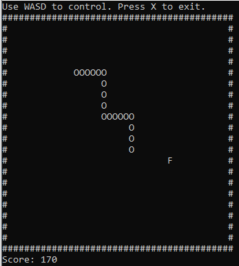

# Snake Game

A C++11 console implementation of Snake for Windows, separating game logic from console handling.

## Gameplay

- Move with **W**, **A**, **S**, and **D**; press **X** to end the round.
- Eat fruit (`F`) to grow and score 10 points.
- A wall or self-collision ends the round.
- Use **Y** or **N** at the game-over prompt to restart or exit.

## Code to review

- [Movement, scoring, and collisions](src/Game.cpp)
- [Console support and restart menu](src/Console.cpp)
- [Entry point](src/main.cpp)

## Build and run notes

Requires Windows, CMake 3.10 or later, and a C++11 compiler with Windows console headers. The implementation uses Windows APIs and `_kbhit`/`_getch`; it is not currently portable to Linux or macOS.

The CMake executable target is `snake`, with output configured under `output/`. See the [repository guide](../../docs/REPOSITORY_GUIDE.md) for build commands. A fresh build and interactive gameplay have not been verified as part of this README update. No project-owned automated tests are present.

## Next improvements

Extract testable game rules from console I/O before considering variable speed, obstacles, or alternative rendering.

[Back to portfolio](../../README.md)
